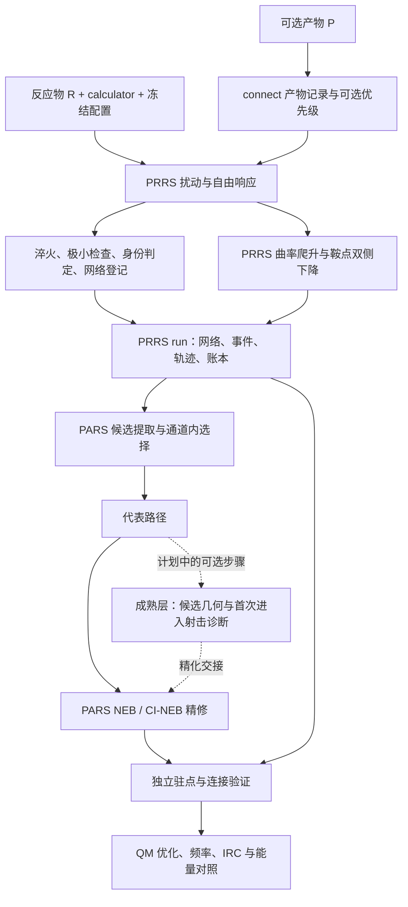

# MLPATH 项目总览：从反应发现到路径验证

整理日期：2026-10-03。本文按当前源码与阶段记录梳理整体逻辑，是项目入口；
实验结论仍引用各自的协议、运行记录和评定结果。“已实现”不等于“已完成科学验收”。

**2026-10-04 实现修复**：续跑计算器/模型/环境身份校验、PARS 端点曲率与盆地参照核对、
不确定度有效性/覆盖门、精修条件分组已落地，见 [修复与验证](FIXES_2026-10-04.md)。
旧运行保留原指纹；多鞍点选择收益与 R8 的科学问题仍未结清。

## 1. 项目在解决什么

给定分子结构和势能计算器，发现可达的化学态与反应通道，再从大量轨迹中挑出值得精化的路径，
最终交付有来源、有连接证据、可被独立 QM 检验的反应结果。

**MLPATH 是整个项目；PRRS 是发现引擎；PARS 是独立的路径筛选与精修模块。**
connect 是 PRRS 在已知产物时的搜索扩展；路径成熟层是计划中的射击诊断工作流。
它们分别处理搜索目标、路径选择和动力学诊断，不是相互替代的算法。

| 层 | 回答的问题 | 输入 → 输出 | 当前实现 |
| --- | --- | --- | --- |
| 势能与可靠性 | 这次能量/力评估能否使用？ | 结构、模型、电荷、配置 → 能量/力或明确拒绝 | ASE calculator factory + `reliability.py`；守卫不代表模型已校准 |
| PRRS 发现 | 从 R 能到哪里？有哪些通道？ | R、势、配置 → 化学态/微态、事件、轨迹、TS 候选 | `src/prrs/` |
| PARS 选择 | 哪些路径值得花精修预算？ | PRRS run → 候选、反应管、前沿/储备、代表路径 | `pars select` |
| 射击诊断 | 某个几何在指定动力学条件下更容易进入 A 还是 B？ | 几何、A/B、动量系综、终止规则 → A/B/未定计数与区间 | PRRS 已有 `shoot`；独立成熟层尚未实现 |
| 路径精修 | 代表路径能否收敛成合理的 MLP 路径？ | 完整种子路径、calculator → NEB/CI-NEB 结果或失败 | `pars refine`；PRRS 另有曲率爬升与双侧下降支路 |
| 局部几何精修 | 给定端点或 TS 初猜能否优化收敛？ | 单个几何、ASE/OpenMM → geomeTRIC 极小／TS 候选或失败 | `prrs optimize`；[使用与验证边界](GEOMETRIC_REFINEMENT.md)，尚未自动串入 PRRS/PARS |
| 独立验证 | 鞍点和两端连接在 QM 上是否成立？ | A/B/TS → 优化、频率、双向 IRC、能量对照 | 体系专用脚本与协议；尚无统一自动交付命令 |

## 2. 数据流

当前可运行的主要链条是 **PRRS → PARS select → PARS refine → 体系专用验证**。
射击原语已存在，但统一成熟层还是后续工程。PRRS 也能在发现期间定位鞍点，
不必每个结果都经过 PARS。

## 3. 两个引擎内部怎么走

### 3.1 PRRS：一个循环与两条诊断支路

1. **取出源微态**：同一化学态可以有多个构象；从水库取起点，受节点、微态、方向、trial 和深度预算约束。
2. **提出方向并交付扰动**：键长、键角、扭转、片段运动等；对称商减少重复，配额决定实际执行集合。
3. **撤去扰动并自由响应**：当前生产自由段使用 NVE；交付段与自由段有不同来源标记。
4. **淬火并检查端点**：驻点性、极小/鞍点性质、可靠性门与身份信息分别记录；失败保留明确原因。
5. **登记和继续**：记录返回、构象变化、反应事件或未决结果；符合条件的新微态进入后续队列。

局部支路分别是：

- **幅度 bracket 与 TS 搜索**：沿某方向寻找返回/离开之间的幅度窗口，再以相关几何启动曲率爬升、鞍点检查和双侧下降。
- **committor 射击**：固定几何，只重新抽热动量，不重复施加原扰动；按固定时窗或启用的首次进入规则计数。

bracket 是指定方向、幅度网格与响应时窗下的搜索记录；位置随 `t_free` 改变已有实测证据。
它不直接给活化能或自由能。首次进入射击已落地，也没有自动改变普通搜索 trial 的终止规则。

源码入口：[search.py](../src/prrs/search.py)、[runner.py](../src/prrs/runner.py)、[config.py](../src/prrs/config.py)。

### 3.2 PARS：先选择，再精修

1. **读取与筛选**：读取 PRRS 的通道归属和轨迹；默认只接收 `completed/reactive` 的 attempt。被排除的记录单列统计，不能把通道存在当成已有可用完整路径。
2. **形成候选**：保留配置指定的 source/free 帧，去掉人工交付与 quench 尾段；保留原帧索引、扰动参数、run/attempt/channel 来源。
3. **通道内比较**：计算能量上冲、扰动严重度、可用的不确定度、几何曲率、回越等廉价目标，归一化后进行 Pareto 分层；缺失量不补造数值。
4. **路径覆盖**：在前沿与近前沿活跃候选中构建反应管、选择代表；冷档案保留来源，审计样本用于后续核验。
5. **保存选择**：输出候选摘要、分层/覆盖账本、归一化参数与代表种子；这一阶段没有因为打分高就完成 TS 认证。
6. **独立精修**：`pars refine` 用显式 calculator 依次做端点弛豫、NEB、CI 检查并记录失败/未决；以后再接独立验证。

“多目标前沿”“反应管”“代表覆盖”是三个不同操作；当前小样本前沿可能很大，
反应管也可能分不开，因此节省了多少成本、保留了多少鞍点仍需独立比较。
当前后端实现为 ASE NEB，string 是设计中的可扩展接口方向。

## 4. 六个对象不能混用

| 对象 | 含义 | 边界 |
| --- | --- | --- |
| 化学态 `chemical_key` | 对称等价下的连通性与构型身份 | 同态仍可能含不同映射键集合与多个构象 |
| 微态 `microstate` | 网络水库里的具体构象与身份记录 | 搜索从微态出发；化学节点不能代替射击的 A/B 两侧 |
| 事件/通道 `event_key`、`reaction_channels` | 对称处理后的反应键变化与通道归属 | 退化反应可表现为同一化学节点上的自环 |
| 轨迹 `DiscoveryTrace` | 实际 trial 的逐帧记录 | 施力、自由响应、quench 的物理含义不同 |
| 路径候选/反应管 `PathCandidate`、`ReactionTube` | 裁剪重采样后的路径及相似路径分组 | 反应管是给定表示与阈值下的聚类，不直接等于独立机理或鞍点 |
| 精修路径/验证结果 | NEB 结果与后续验证等级 | 收敛、驻点认证、QM IRC 属于不同证据等级 |

尤其对 P1：对称商下两端可以属于同一化学节点；判断 A/B 要用映射后的两侧身份与键集合。
“只有一个节点”不表示没有反应，“27 条路径”也不表示有 27 个鞍点。

身份的权威在 PRRS。PARS 经文件读取通道、键图和来源，禁止 `import prrs`，不重新猜身份。
契约集中在 [PRRS schema](../src/prrs/schema.py) 与 [PARS adapter](../pars/src/pars/adapters/prrs_run.py)。

## 5. discover、connect、成熟层分别改变什么

| 工作 | 已知信息 | 改变的位置 | 当前边界 |
| --- | --- | --- | --- |
| discover | R | 默认发现循环 | 不要求输入 P |
| connect | R、P；原子映射一致 | 记录到 P 的距离；可选调整队列与方向先后 | 同一身份、admit 和可靠性规则；不是完整 Langevin/Doob 桥 |
| 成熟层 | 已发现的 A/B 通道和代表路径 | 下游候选、独立射击与精化交接 | 施工计划；`prrs mature prepare\|shoot\|report` 尚不可用 |
| QM handoff | 待独立核验的路径/鞍点 | 势能面和验证等级 | 横跨 discover/connect；当前不是 `prrs` 的独立模式命令 |

当前 connect 用法为 `prrs search ... --product P.xyz`；配置
`connect_queue_priority`、`connect_direction_priority` 分别控制两个排序干预，默认关闭。
计划中的 `--mode discover|connect` 尚未接入 CLI。
路径输出分 `observed` 与 `any_evidence` 视图；后者还可使用 continuation 与 TS 连接证据。
仍按既有预算/队列条件终止，未实现“首次到达 P 就停”的新规则。

部分 CLI help/docstring 仍沿用 G1 时期的“只记录不路由”描述；启用排序时的实际行为
以配置和调度实现为准。这是待同步的接口说明债，不是另一套模式。

## 6. 当前进度：实现、实测、研究分别看

| 工作线 | 已有 | 还缺什么 | 依据 |
| --- | --- | --- | --- |
| PRRS 核心 | 身份/对称处理、方向账本、TS 支路、schema、续跑、首次进入射击等实现 | 普通搜索 bracket 的时窗语义仍有 R8 未决事项 | [HANDOFF](HANDOFF.md)、[待决记录末节](DECISIONS_PENDING.md) 与源码 |
| connect 图层 | G1 产物记录、G2 按距离排队、G3 键差方向优先级、G4 路径输出 | G2 尚无学习的图层 h；G4 新终止规则未做；G5 仅探索；参照与冻结验收不全 | [connect 计划及进度](PLAN_2026-09-28.md) |
| connect 原子桥/两端版本 | L/E 设计任务已拆分 | Langevin、Doob 修正、近似 h、两端版本尚未实施 | 同上 |
| PARS | 独立包；select/refine；10-02 修复与 P1 全量精修记录 | 多通道/多鞍点选择有效性、反应管描述符、压缩策略；factory 字符串无法检测内部换模型 | [PARS 审查](PARS_REVIEW_2026-10-02.md) |
| 路径成熟层 | 复用原语与文件契约的 M0–M6 计划 | 模块、CLI、独立账本、预算与续跑尚未施工；Q/B 为后续研究 | [成熟层计划](PLAN_GEN_COMPAS_MATURATION_2026-10-03.md) |
| 基准与 QM | P0–P3 冻结回归夹具；P1/b04 有独立 QM 连接核验记录 | b05 判据/竞争通道与交付闭环；不能直接当已确认的多鞍点参照集 | [基准索引](../benchmarks/README.md)、各体系协议 |
| 完备性 | 有限定子空间的测量/审计机器 | 命题与上界前提仍不足以签发正式证书，保留 DRAFT | [completeness.py](../src/prrs/completeness.py)、决策 4 |

PARS 已记录实测：修复后 P1 的 27 个候选全部精修到同一个约 0.419 eV 的 MLP 鞍点。
这支持该数据上的精修工程验证；**单鞍点数据不能验证选择是否保留多机理多样性**。
本次未重新执行科学实验，数值来源为 10-02 审查记录。

## 7. 证据怎么读

交付分别回答：观察到什么轨迹、端点是否确认、事件身份是否明确、鞍点是否认证、
两侧是否连到预期 A/B、独立 QM 核验到哪一级。不能由同一个“成功”标签代替。

- `observed_stepwise` 与 `observed_direct` 各自要求正证据；没找到则为 `unanswered`，同时报覆盖、门拒绝和预算原因。
- `p_B_given_AB = B/(A+B)` 要连同未定、失败、第三盆、入口核对不一致、区间与系综/终止规则报告；`A+B=0` 无可用比例。
- NEB/CI-NEB 收敛不代替 Hessian 驻点认证与双侧连接验证；QM 单点不代替 QM TS 优化、频率和 IRC。
- 搜索幅度、响应曲率、路径评分、力不确定度各有单位与含义，不自动给自由能、速率或全空间完备性。

MLP 上的搜索质量与 MLP 对 QM 的误差分别评估。P1 已记录的 MLP/QM 势垒差异
不能从“几何和连接核验成立”中抹掉，也不能据此删除已观察的反应事件。

## 8. 代码与文件地图

| 位置 | 职责 | 阅读入口 |
| --- | --- | --- |
| `src/prrs/config.py`、`cli.py` | 协议校验与可运行命令 | `prrs --help`；根 README |
| `src/prrs/search.py` | 预算、队列、扫描、局部支路、发布与续跑 | `ReactionSearch.run`、`DirectionSchedule` |
| `src/prrs/runner.py` | 动力学、quench、曲率、爬升、下降、射击 | `run_trial`、`quench`、`shoot` |
| `src/prrs/internal.py`、`perturbations.py` | 坐标运动、提案、对称商与方向覆盖 | [扰动导读](onboarding/02-内坐标与扰动.md) |
| `src/prrs/state.py`、`chemistry.py`、`canonical.py`、`network.py` | 图编码、身份、正则标号、构象水库与登记 | [身份导读](onboarding/04-化学身份与反应网络.md)；新实现以源码为准 |
| `src/prrs/product.py`、`completeness.py` | 产物距离/路径视图；限定子空间审计 | 两个独立职责，不并入普通身份 |
| `src/prrs/calculators.py`、`reliability.py`、`openmm_backend.py`、`torch_guard.py` | 势与后端适配、守卫、环境保护 | [环境记录](../env/BASELINE.md) |
| `src/prrs/geometric_backend.py`、`geometric_cli.py` | 可选 geomeTRIC 局部极小／TS 候选优化，单位转换与状态落盘 | [精修说明](GEOMETRIC_REFINEMENT.md) |
| `pars/src/pars/{adapters,paths,frontier,refinement}/` | 文件适配、路径表示、选择覆盖、NEB | [PARS README](../pars/README.md) |
| `tests/`、`pars/tests/` | 两个包各自的行为测试 | 两套 Makefile；根 `pytest` 不包含 PARS 测试 |
| `benchmarks/` | 体系构建、前置门、判据与评定 | [基准索引](../benchmarks/README.md) |
| `docs/experiments/`、`scripts/` | 研究测量/评定；运行/远程/QM 工具 | 从引用它们的协议进入，不把每个脚本当生产入口 |
| `runs/`、`models/` | 运行证据；模型目录 | manifest 是来源依据，不按当前代码覆盖旧结果 |

PRRS 关键交付为 `config.json` manifest、`network.json`、`attempts.jsonl` 与对应轨迹/几何。
PARS 输出 `pars_selection.json`、`candidates.jsonl`、`representatives/` 和 `refined/`。
未来成熟层用新输出目录，不向旧 run 中回填射击结果或覆盖来源。

## 9. 后续工作建议次序

以下建议不替代冻结协议或历史用户裁决：

1. **统一基线与输入契约**：分别记录 PRRS/PARS 的实现、模型、环境与来源；清点指定 run，不凭目录名或 factory 字符串推断模型一致。
2. **形成可复核的交付链**：若推进成熟层，按 M0→M4 实现契约、候选、射击账本和交接，再按 M5 做 P1 工程验证。
3. **建立多通道参照集**：先确认鞍点与连接，再用同预算实验评价 PARS 选择/覆盖与 M6。P1 工程验证与此可以分别推进。
4. **connect 单独验收**：补测试台可达性、参照与 T2 协议，再测 G5；绕路未到 P 包含方向未选与幅度不足，不能直接归因于队列策略。
5. **在基线之上研究学习与生成**：学习 q、生成候选、原子桥分别立实验；位置 q 与相空间 h 的定义、动力学系综和验证对象写清楚。

当前跨工作线的未决事项：R8 搜索时窗语义、PARS 描述符/压缩策略与多鞍点参照、
connect 新终止规则和未完成协议、b05 判据收口、决策 6 的 B′ 周期坐标负曲率打磨、
DRAFT 完备性命题，以及性能项测量优先级。
首次进入射击 **R6** 已结清；它与上述 **决策 6（B′）** 是不同编号体系，不能一并销项。
详情仍在各工作线原件中。

## 10. 文档维护规则

- **总体关系与阶段状态**更新本文；**找文档**用 [docs/README.md](README.md)。
- **新决策**记来源、工作线与生效范围；**完成记录**进 `DONE_LOG.md` 或日期报告。
- **冻结协议**保留原文，变更另立修订/新批次，不回写旧判据。
- **历史计划**保留任务编号与链接；过期入口加指向，不要求读者从日记中拼出当前项目。
- **算法改动**按范围跑根 `make check` 或 `make -C pars check`；文档整理检查链接与来源，不启动长时间科学计算。

源码指纹用 `make hash` 现算；当前只覆盖 `src/prrs/*.py`，不覆盖 PARS、实验脚本和文档。
旧 run 保留自己的实现哈希。本次文档整理不能作为算法回归或科学验收通过的证据。
