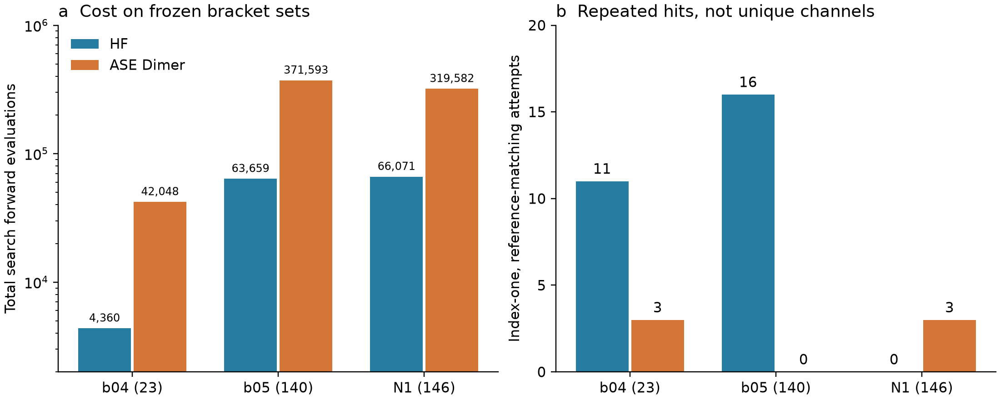
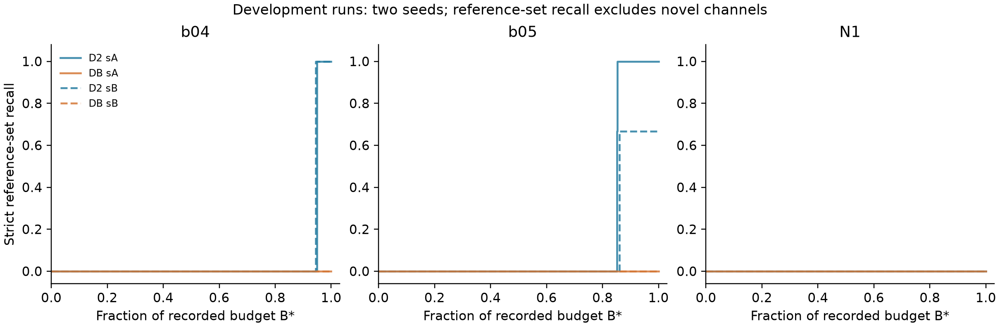

# MLPATH: Energy-and-force transition-state search through constrained reaction branches

Working manuscript, version 0.1 — 13 November 2026. Results describe the saved development cohorts completed through 12 November 2026. The method configurations differ between cohorts, and the present comparison is exploratory. Supporting Information (SI) records the settings, evidence sources, and outstanding validation boundaries.

## Abstract

Finding transition states from reactant structures requires both generating useful guesses and refining them to stationary points. We describe MLPATH, a workflow that combines constrained molecular scans, continuation of local reaction branches, and energy-and-force refinement of a bracketed branch maximum. Searches produce persistent stationary-point candidates; saddle order, endpoint connectivity, and electronic-structure validation are evaluated separately. We examine three molecular systems on the float32 MACE-POLAR-1-M potential using frozen local-search inputs and two end-to-end seeds. On chloride exchange and base-induced elimination, the local locator used 4,360 and 63,659 forward evaluations, respectively, compared with 42,048 and 371,593 for the default ASE Dimer baseline, while producing more index-one candidates that matched the designated references. At the recorded end-to-end budgets, MLPATH recovered the chloride-exchange reference in both seeds and the three elimination references in one seed; two references passed strict certification in the second seed, with the third geometrically matched but its order unresolved. The same workflow missed all four designated concerted Diels–Alder references. Dimer recovered two Diels–Alder reference classes in local searches and identified an additional substitution channel outside the elimination reference set. These results establish useful local efficiency on selected branches and expose the importance of coordinate coverage, reference construction, and numerical certification when assessing reactant-based transition-state search.

## 1. Introduction

A search beginning from reactants must choose which configurations and directions to investigate before it can refine a transition state. This creates two distinct computational tasks: locating a saddle from an informative guess, and obtaining such guesses within a finite search budget. Their costs and failure modes can differ substantially. A fast local optimizer can contribute little to discovery if its input generator does not reach the relevant transition region.

Saddle searches based on first derivatives already provide an established route to avoiding explicit potential-energy Hessians. The dimer method locates saddles without a supplied product structure [1]. When endpoint structures are available, climbing-image nudged elastic band calculations address the path between those endpoints [2]. These precedents make access to energies and forces a practical starting point, while requiring care about the information given to each search. Here the comparison concerns a branch-based workflow and a specified Dimer implementation under stated input and budget contracts.

MLPATH investigates whether constrained scans can supply useful, interpretable local branches for transition-state location on a machine-learning potential. On a smooth branch of constrained minima, the energy derivative along the constrained coordinate can bracket a local maximum. The search then becomes a sequence of transverse relaxations and bounded updates of that bracket. This construction also exposes a limitation: a selected coordinate and a locally followed branch may lead to a different saddle from the mechanism of interest, or may lose continuity before reaching a stationary point.

We examine these issues using chloride exchange, base-induced elimination, and a cyclopentadiene–acrolein system with concerted Diels–Alder references. We first compare local searches on frozen scan-derived inputs, then compare reactant-pose searches at the same recorded forward budgets. We retain failures, unresolved saddle character, and reference-external discoveries. The contribution evaluated here is the combination of branch-based guess generation, E/F stationary-point location, and explicit search accounting. The experiments assess its efficiency and coverage on the selected potential-energy surface.

## 2. Methods

### 2.1. Inputs, search stages, and evidence levels

MLPATH accepts molecular structures with an explicit total charge and spin multiplicity. The current molecular locator supports nonperiodic systems. A preparation stage generates a finite library of reactant conformations and relative poses, denoted L0. Distance-based search intents define constrained scans from those poses. The evaluated D2 workflow uses individual distance primitives for these scans; it receives no reference product structure or reference unstable eigenvector.

The scans provide candidate ridges and branch discontinuities for bounded local searches, denoted HS. Stationary candidates can subsequently undergo E/F two-sided connection tracking, denoted HC. A search record distinguishes its geometry and force residuals from independently evaluated saddle order, endpoint assignments, and QM evidence. Thus a converged HS candidate is a force-converged geometry; its index-one character requires a separate check.

The term Hessian-free refers to the molecular E/F search and connection routines. These routines do not request a full model Hessian or reconstruct one through coordinate-wise force differences. Constrained BFGS relaxation can maintain a dense secant approximation learned from energy/force trajectories. Consequently, this implementation makes no matrix-free memory-scaling claim. Full curvature information remains available to the separate validation stage.

### 2.2. Constrained branches and the coordinate derivative

Let \(x\) denote Cartesian coordinates, \(E(x)\) the potential energy, and \(F(x)=-\nabla E(x)\) the force. For a scalar intent coordinate \(q(x)\), write \(g(x)=\nabla q(x)\). At a prescribed value \(q_0\), transverse relaxation minimizes energy subject to \(q(x)=q_0\). The recorded coordinate derivative is

\[
s(x)=-\frac{F(x)\cdot g(x)}{g(x)\cdot g(x)},
\]

and the transverse force is

\[
F_\perp(x)=F(x)+s(x)g(x).
\]

The implementation stores \(s\) as `reaction_force`; this manuscript uses the explicit sign convention above. On a differentiable, transversely stationary branch, \(s=dE_*/dq\). A resolved positive derivative followed by a negative derivative brackets a branch maximum. This local construction relies on branch continuity and transverse stability. The numerical search checks continuity diagnostics, while independent curvature validation assesses the stationary-point character.

Saved bracket endpoints are re-relaxed before their slopes are used. Each trial coordinate is approached independently from both sides of the bracket. The two relaxed structures must satisfy geometric agreement and paired derivative checks. Geometry or force disagreement leaves the search unresolved. Unconverged frames remain diagnostic records and do not establish a reaction-force sign change.

### 2.3. Refinement and numerical stopping

The core refinement uses bounded bisection of the constrained coordinate. Within one accepted branch, projected BFGS information and a bounded geometric predictor can reduce repeated relaxation work. Trial state is committed after acceptance. Rejected trial information does not replace the last accepted branch state.

The later bracket configuration adds coarse and fine midpoint stages. When both coarse continuations agree geometrically and have the same resolved derivative sign, the bracket can be reduced before fine relaxation. Near the root, the fine stage uses FIRE [3]. Candidate recognition in the later configuration also considers eligible coarse-stage and endpoint frames. Earlier cohorts retain their recorded earlier settings; the study is therefore a comparison of development configurations, not a validation of one universally frozen configuration.

Stationary candidates must satisfy a maximum atomic full-force norm of 0.01 eV Å⁻¹, a transverse-force norm of 0.003 eV Å⁻¹, and a coordinate residual of at most \(10^{-8}\) in the coordinate's native units. Fine midpoint relaxation uses a tighter transverse threshold of 0.001 eV Å⁻¹ where configured. Sign-resolution thresholds guide bracket updates; full Cartesian force controls candidate stationarity. SI Section S2 reports the cohort-specific values.

### 2.4. Molecular potential and benchmark systems

All HF-6 molecular searches used the float32 MACE-POLAR-1-M checkpoint through its `PolarMACE` calculator interface. The model family incorporates electrostatic and charge/spin treatment [4]. Charge and multiplicity are set explicitly: −1 and singlet for the two anionic systems, and neutral singlet for cyclopentadiene–acrolein. Model-family literature is distinct from the provenance and accuracy of the particular local checkpoint, whose historical record is retained in the benchmark files.

The first system, b04, is chloride exchange in Cl⁻ + CH₃Cl, with one designated SN2 reference. The second, b05, combines hydroxide with tert-butyl chloride and has three designated E2 reference geometries. These three references represent geometrically distinguished saddles within elimination chemistry. The third, N1, combines cyclopentadiene with acrolein and has four designated concerted Diels–Alder references: endo/exo combined with s-cis/s-trans arrangements.

The b04 reference has historical QM refinement, frequency, and IRC evidence. Representative b05 structures have later QM optimization and frequency records. N1 references were established on the model surface and have no corresponding QM validation in the present dataset. The principal search comparison concerns the specified model surface; chemical energetics and model accuracy require their own evidence.

### 2.5. Local and end-to-end comparisons

The local comparison contains 23 b04, 140 b05, and 146 N1 frozen HS inputs. HF replays the respective run's recorded local settings. Dimer starts at the highest-energy scan point within the corresponding bracket and receives the normalized gradient of the same intent coordinate as its initial direction. HF receives the bracket endpoints. This matches the scan-derived input source and permitted directional information while retaining the distinct initialization contracts of the two algorithms. Both arms have a 3,000-forward cap per item and a 0.01 eV Å⁻¹ full-force threshold.

The baseline is ASE Dimer, implemented with `DimerControl`, `MinModeAtoms`, and `MinModeTranslate` [5]. Dimer parameters retain the ASE defaults used by the benchmark, including a separation of \(10^{-4}\) Å. The experiments establish a comparison with that configuration. Numerical suitability of the default separation under fp32 noise has not been calibrated across configurations.

For the end-to-end comparison, D2 results are taken from existing development runs. The DB baseline receives the same saved L0 poses and a budget equal to the recorded D2 ledger total for that system and seed. It cycles through poses with random initial modes and a Gaussian displacement of standard deviation 0.1 Å, using bounded Dimer attempts. Two seeds are evaluated. This is a forward-count comparison beginning from a shared saved pose library; the figure does not measure complete wall time from unprepared reactant inputs.

D2's ledger includes its charged scan, search, and connection work. DB's search ledger covers its Dimer attempts. Search-independent Hessian validation and subsequent identity investigations are accounted for separately. Comparisons requiring a common cost through fully validated endpoint assignments remain additional work.

### 2.6. Reference scoring and independent validation

Converged candidates from both arms are checked with the same post-search saddle-order routine. A strict reference hit requires both index-one classification and a reference match within 0.15 Å symmetry-aware RMSD and 0.05 eV energy difference. Unresolved order remains unresolved even when the geometry matches. These are held search-independent checks, rather than an external implementation of the entire validation stack.

The stored matching procedure considers permutations from the saddle graph and the reactant-pose graph. A separate saved mirror audit identifies one additional N1 local Dimer reference hit. For this achiral benchmark, the manuscript includes that audited mirror correspondence. It leaves historical summaries unchanged and records the correction explicitly in the derived data.

For a designated reference set \(S\), we define the observed recall at recorded search cost \(b\) as

\[
R_S(b)=\frac{\#\{r\in S:\text{an index-one match to }r\text{ is recorded by }b\}}{|S|}.
\]

A reference not found by the budget limit is recorded as unobserved within that budget. Reference-external saddles are reported separately. In particular, the b05 reference set was extracted from D2 events, so its recall is an asymmetric coverage measure and does not enumerate all possible reaction channels.

## 3. Results

### 3.1. Local search is economical on the chloride-exchange and elimination inputs

Table 1 separates convergence, index-one classification, and strict reference hits. HF produced 11 index-one reference hits from the 23 b04 inputs, compared with three for Dimer. Total local-search costs were 4,360 and 42,048 forwards, a 9.64-fold difference. In b05, HF produced 19 candidates, of which 16 passed index-one validation and matched the references. Dimer produced 15 index-one candidates but none matched the three E2 references. HF used 63,659 forwards, compared with 371,593 for Dimer, a 5.84-fold difference.

**Table 1. Local searches on frozen scan-derived inputs.** Strict hits require index-one classification and reference matching. Repeated hits to the same reference are counted as separate successful attempts.

| System | Inputs per arm | Arm | Converged candidates | Index-one candidates | Strict reference hits | Total search forwards |
| --- | ---: | --- | ---: | ---: | ---: | ---: |
| b04 | 23 | HF | 11 | 11 | 11 | 4,360 |
| b04 | 23 | Dimer | 10 | 3 | 3 | 42,048 |
| b05 | 140 | HF | 19 | 16 | 16 | 63,659 |
| b05 | 140 | Dimer | 27 | 15 | 0 | 371,593 |
| N1 | 146 | HF | 4 | 4 | 0 | 66,071 |
| N1 | 146 | Dimer | 70 | 28 | 3 | 319,582 |

The N1 Dimer strict-hit count includes the saved mirror correction. The three hits correspond to two designated DA references. The 19 b05 HF geometric matches include three candidates with unresolved order; they are excluded from the strict-hit column. Index-one classifications are those in the specified saved validation snapshot.

**Figure 1. Local cost and validated reference hits.** (a) Total forward evaluations across each frozen input set, including failed searches. (b) Index-one, reference-matching attempts, including repeated hits. Parenthetical axis labels give input counts. Costs exclude generation of the frozen scan inputs and post-search validation. The bars measure computational expenditure and designated-reference hits within each cohort, rather than unique-channel yield or wall-time acceleration.

### 3.2. End-to-end reference recovery occurs late in the available budget

At matched recorded budgets, D2 recovered the b04 reference in both seeds. Its first strict hits occurred at 24,800 of 26,129 forwards and 26,506 of 28,071 forwards. For b05, seed sA recovered all three E2 references, while seed sB recovered two under strict scoring. The remaining sB candidate matched the reference within 0.006 Å but had unresolved order because an internal-mode recheck disagreed. DB produced no strict matches to the designated references in these runs.

**Table 2. End-to-end designated-reference recall at the recorded budget limit.** The two arms share the saved pose library. Each seed has its own D2-derived budget.

| System | Reference count | Budget sA / sB, forwards | D2 sA | D2 sB | DB sA | DB sB |
| --- | ---: | --- | --- | --- | --- | --- |
| b04 | 1 | 26,129 / 28,071 | 1/1 | 1/1 | 0/1 | 0/1 |
| b05 | 3 | 408,888 / 405,075 | 3/3 | 2/3 | 0/3 | 0/3 |
| N1 | 4 | 376,296 / 377,745 | 0/4 | 0/4 | 0/4 | 0/4 |

**Figure 2. Strict reference-set recall versus cumulative recorded budget.** Steps use saved per-reference first-hit costs. Solid and dashed curves indicate sA and sB. Zero-valued curves overlap. Missing references remain unobserved at the budget limit. Reference-external discoveries, including the b05 substitution saddle, do not enter this metric. The two-seed development runs are shown individually without confidence bands.

The positive b04 and b05 hits appear after approximately 85–95% of the final recorded budget. D2 completes its scan phase before local refinement, and all three systems have zero designated-reference recall at three quarters of the budget. Thus the local cost advantage coexists with substantial front-loaded exploration expense. The present data motivate examining scheduling, but do not establish a benefit from an alternative schedule.

### 3.3. The concerted Diels–Alder references remain outside the observed D2 coverage

Neither D2 seed recovered any of the four concerted DA references. In the local comparison, HF returned four index-one candidates without a DA reference match, while Dimer found three matching candidates spanning endo s-cis and exo s-cis after the mirror correction. This distinguishes failure of the constrained workflow on these inputs from absence of the designated DA saddles on the model surface.

HF-5 connection records assigned the D2 N1 events to single-C–C-bond changes, and the corresponding saddle geometries were distinct from the designated DA references. A subsequent descent audit classified one saddle shared with D2 as leading to a two-bond product under a different endpoint procedure. The difference in endpoint assignments remains unresolved. We therefore use reference geometry and independently checked saddle order for DA recall and retain the endpoint-protocol discrepancy in SI, rather than assigning every N1 event a settled mechanism.

The observations are consistent with limitations in coordinate and pose coverage. They do not isolate those effects from loss of a constrained branch or transverse relaxation failures. The negative result is retained as a boundary of the evaluated workflow.

### 3.4. Reference-external Dimer discoveries expose incomplete coverage measures

A later audit grouped Dimer candidates that had passed index-one validation but had not matched the designated references. Across the local and two end-to-end cohorts, b05 contributed 42 candidates grouped into 24 representatives. One group contained six observations of a substitution saddle: four in local searches and two in end-to-end seed sB. E/F descent connected one side to the reactant bond graph and the other to a tert-butanol/chloride bond graph. The saddle lay approximately 0.45 eV above the lowest designated E2 saddle on the evaluated potential, and was geometrically distinct from the D2 events.

This group provides a candidate substitution connection missed by the evaluated D2 runs. Endpoint minima have not been Hessian-certified and no QM check is available for it. Its energy difference is a model-surface saddle comparison, rather than a difference in activation barriers or a prediction of product selectivity.

The same audit found ten N1 groups with different endpoint bond graphs and one endpoint matching the reactant graph. These included a designated DA mirror counterpart and additional proposed channels. Some initially index-one candidates became unresolved on recheck. Together, these results show why designated-reference recovery, all index-one geometries, and provisionally assigned reaction connections need separate reporting.

## 4. Discussion

The local comparison supports a concrete use case for the E/F branch locator: informative scan-derived brackets can allow stationary-point location at low forward cost on the b04 and b05 inputs. The full-force stopping rule is important to that interpretation. A resolved coordinate derivative guides the search, while a candidate is accepted only after the full molecular residual is small. Independent saddle-order validation then determines whether that stationary geometry has index-one character.

Coverage is the complementary issue. A restricted coordinate and continuation procedure can efficiently find the saddles it reaches while overlooking other channels. N1 supplies a measured failure on the designated concerted DA set. The additional b05 substitution saddle also shows that a reference set derived from one search arm can overstate the apparent completeness of that arm's discoveries. A submission-level comparison should retain a predefined reference subset and supplement it with equivalently validated discoveries from either method.

Two numerical issues affect generalization. First, the development cohorts use different branch settings and system-specific noise measurements. The same-graph ridge heuristic used for expenditure reduction in b05 has counterexamples in b04 and N1. Second, float32 curvature checks leave some saddle orders unresolved and can change classification upon re-evaluation. These findings call for a fixed calibration and validation procedure before broad transferability claims. They also limit the interpretation of a comparison against one default Dimer setting.

The distinction between local and end-to-end cost remains consequential. Local HF efficiency does not remove the cost of creating its brackets, and D2's delayed first hits show that scan scheduling can dominate the usable budget. Validation is also not free: D2 carries connection work in its search ledger, whereas DB has subsequent descent audits outside that ledger. Future cost-through-confirmation comparisons should apply a common endpoint-validation contract and report that additional expenditure for both arms.

The present evidence supports a bounded methods study and an explicit account of its failure modes. The data comprise three development systems, one local input cohort per system, and two end-to-end seeds. They do not provide a held-out multi-system success rate, calibrated confidence intervals, comprehensive channel coverage, or general chemical accuracy of the underlying potential. Additional frozen validation would strengthen the efficiency claim and determine how far it transfers beyond the branches studied here.

## 5. Conclusions

MLPATH combines constrained scanning, local branch continuation, and E/F refinement with explicit separation of search geometry, saddle character, and endpoint evidence. The saved b04 and b05 local cohorts demonstrate lower forward expenditure than the evaluated default ASE Dimer baseline, and end-to-end runs recover their designated references with one unresolved b05 classification. The missed concerted DA references and a Dimer-discovered substitution saddle define important coverage limits. Together, these results support further evaluation of branch-based E/F search using frozen numerical rules, reference sets independent of the search arm, and common validation costs.

## Data and code availability

This working draft is accompanied by a local evidence package under `paper/`. Its extraction script regenerates tables, per-item scoring records, and the two figures from the saved HF-6 summaries and mirror audit without running a molecular model. SI Section S1 lists the source artifacts. The public release, checkpoint distribution permissions, complete environment capture, and archival identifier have not yet been established.

## References

1. Henkelman, G.; Jónsson, H. A dimer method for finding saddle points on high dimensional potential surfaces using only first derivatives. *J. Chem. Phys.* **1999**, *111*, 7010–7022. [doi:10.1063/1.480097](https://doi.org/10.1063/1.480097).
2. Henkelman, G.; Uberuaga, B. P.; Jónsson, H. A climbing image nudged elastic band method for finding saddle points and minimum energy paths. *J. Chem. Phys.* **2000**, *113*, 9901–9904. [doi:10.1063/1.1329672](https://doi.org/10.1063/1.1329672).
3. Bitzek, E.; Koskinen, P.; Gähler, F.; Moseler, M.; Gumbsch, P. Structural Relaxation Made Simple. *Phys. Rev. Lett.* **2006**, *97*, 170201. [doi:10.1103/PhysRevLett.97.170201](https://doi.org/10.1103/PhysRevLett.97.170201).
4. Batatia, I. et al. MACE-POLAR-1: A Polarisable Electrostatic Foundation Model for Molecular Chemistry. **2026**, arXiv:2602.19411v1. [Author manuscript](https://arxiv.org/abs/2602.19411v1).
5. Larsen, A. H. et al. The atomic simulation environment—a Python library for working with atoms. *J. Phys.: Condens. Matter* **2017**, *29*, 273002. [doi:10.1088/1361-648X/aa680e](https://doi.org/10.1088/1361-648X/aa680e).
